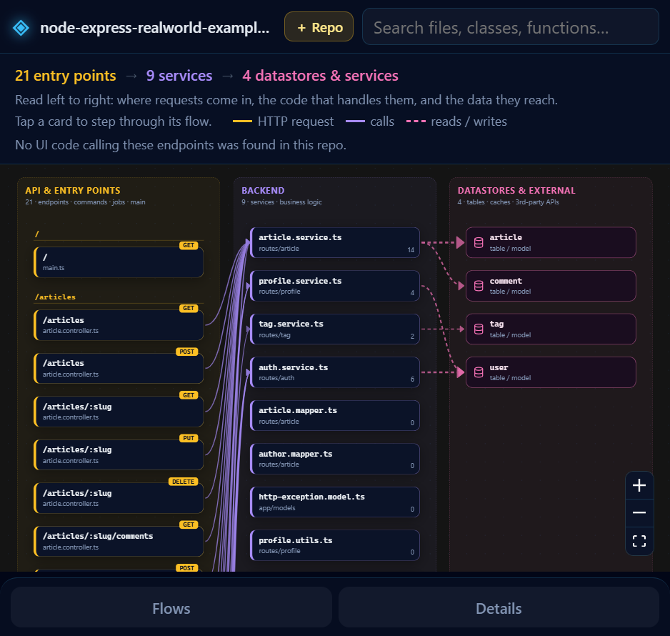

# Tesseract: Codebase Workflow

See the repository you have open as an interactive end-to-end workflow: **UI screens → API endpoints → services → datastores and external services**. Hover a card to trace its path, click it to step through the flow, and jump straight to the code.

**Everything runs locally.** Your code is parsed on your machine and never uploaded, so it works on private repositories.

## Use

- Click **Workflow** in the status bar, run **Tesseract: Show Codebase Workflow** from the Command Palette, or right-click a folder in the Explorer.
- Hover a card to highlight everything it connects to; click an endpoint or screen to play its flow step by step.
- **Open in editor ↗** in the details panel jumps to the selected function.
- The map refreshes in the background when you save (`tesseract.refreshOnSave`).

## What it understands

Static analysis with tree-sitter for JavaScript, TypeScript, Python, Go, Java, Kotlin, Scala, Rust, Ruby, PHP, C#, C, C++, Objective-C, Swift, Elixir, OCaml, Solidity and Bash. It recognizes routes and HTTP calls in common frameworks (Express, Koa, NestJS, Next.js, FastAPI, Flask, Django, Rails, Laravel, Spring, ASP.NET, Gin and more), links frontend requests to the backend endpoints they hit, and detects databases, ORMs, caches and third-party APIs.

Behavior wired up only at runtime (string-based dispatch, dependency-injection containers, reflection) can show up as gaps in a flow.

## Settings

| Setting | Default | Description |
|---|---|---|
| `tesseract.refreshOnSave` | `true` | Re-analyze in the background when a file is saved while the workflow is open |
| `tesseract.showStatusBarButton` | `true` | Show the Workflow button in the status bar |

Public repositories can also be explored in the browser at [repo-analyser-two.vercel.app](https://repo-analyser-two.vercel.app). Source and issues: [github.com/sharad272/RepoAnalyser](https://github.com/sharad272/RepoAnalyser).
